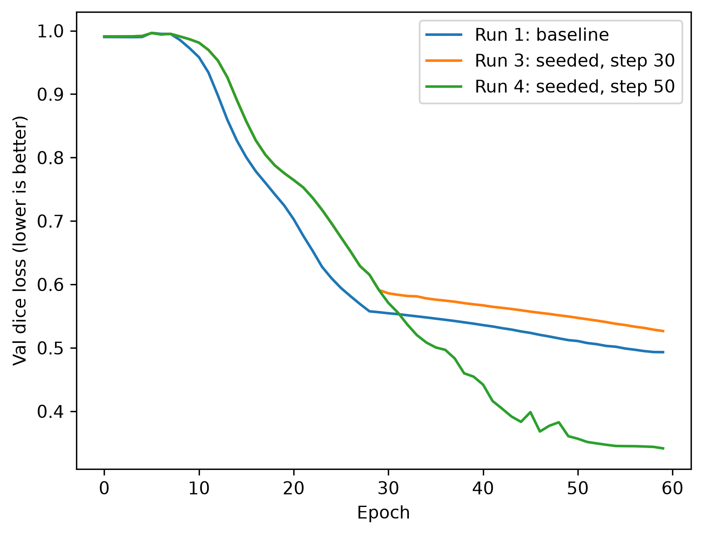

# ML Practice

A hands-on log of my machine learning fundamentals, from classical ML with scikit-learn to image segmentation with PyTorch.

## About

I'm a Computer Science student focusing on AI/ML, with a long-term interest in **computer vision and medical imaging**. I'm a U.S. Navy veteran, I hold a prior degree in supply chain, and I've worked in industry, including backend and tooling work at a robotics company.

This repo documents how I'm building my ML foundation: learning the core workflow first, then moving to deep learning on image data and running controlled experiments.

## Projects

| Project | Notebook | Model | Result | Key concepts |
|---|---|---|---|---|
| Iris species classification | [`iris.ipynb`](iris.ipynb) | k-Nearest Neighbors (k=5) | 100% accuracy on a 30-flower held-out test set | Features vs. labels, stratified train/test split, fit / predict / score |
| Shape segmentation | [`unet.ipynb`](unet.ipynb) | UNet (PyTorch) | Val dice loss 0.527 → 0.342 from one controlled change | Encoder/decoder, skip connections, dice loss, learning-rate scheduling, seeded experiments |

---

### Iris species classification

Predicts a flower's species (setosa, versicolor, virginica) from four measurements: sepal length and width, and petal length and width.

**Approach**
1. Loaded the dataset and explored it. It's sorted by species, which matters for splitting.
2. Split 80/20 into training and test sets with `stratify=y`, so each species is equally represented in both (40/40/40 train, 10/10/10 test).
3. Trained a k-Nearest Neighbors classifier on the training set only.
4. Predicted on the unseen test set and scored with `accuracy_score`.

**Takeaways**
- An unshuffled split of sorted data would put a species in the test set that the model never trained on. Shuffling and stratifying prevent that.
- Iris is an easy dataset: the species separate cleanly by petal size. A perfect score on 30 samples is a sanity check for the workflow, not proof of a perfect model.

---

### Shape segmentation with UNet

A UNet trained to segment six shape types (squares, circles, rings, triangles, mesh squares, plus signs) in 192×192 synthetic images. The model predicts a mask for each shape type, labeling every pixel. This is the same kind of task as segmenting structures in medical scans.

**Architecture**
- **Encoder:** four blocks of two 3×3 convolutions + ReLU, each followed by 2×2 max pooling (192 → 96 → 48 → 24 → 12), with channels growing 64 → 1024.
- **Decoder:** transposed convolutions upsample back to 192×192. **Skip connections** concatenate each decoder stage with the matching encoder stage, combining *what* the deep layers detect with *where* the early layers saw it.
- **Output:** a 1×1 convolution gives 6 scores per pixel, one per shape type.
- **Loss:** 50/50 mix of binary cross-entropy and dice loss (dice measures overlap between predicted and true masks; 0 = perfect).

**Experiment: when to lower the learning rate**

The baseline used `StepLR` to cut the learning rate 10× at epoch 30. The loss curve flattened right at that drop while the model was still improving, which suggested the cut came too early.

To test this fairly, I fixed the random seeds (Python, NumPy, PyTorch) so both runs used identical data, starting weights and batch order. Then I changed one setting:

| Run | Seeded | `step_size` | Final val dice loss |
|---|---|---|---|
| 1 | No | 30 | 0.493 |
| 3 | Yes | 30 | 0.527 |
| 4 | Yes | **50** | **0.342** |



Runs 3 and 4 are identical through epoch 29, which confirms the seeding worked. They split exactly when run 3's learning rate drops. Keeping the higher learning rate 20 epochs longer improved validation dice loss from 0.527 to 0.342, roughly 47% → 66% mask overlap.

**Other changes I made**
- Fixed the order of `scheduler.step()`. It was called before `optimizer.step()`, which shifted every learning-rate drop one epoch early.
- Added per-epoch logging of train/val metrics to CSV, so runs can be compared and re-plotted.
- Corrected the shape comments to match the actual 192×192 input.

**Observations**
- In early runs, the model located shapes well but often confused *which* shape type each one was. Mesh squares, which have a distinctive texture, were classified most reliably.
- Run 4's curve flattens again at its own learning-rate drop (epoch 50), so longer training is the next thing to test.

**Credit:** the synthetic dataset generator and training loop are adapted from [usuyama/pytorch-unet](https://github.com/usuyama/pytorch-unet).

---

## Roadmap

- [x] Core scikit-learn workflow on Iris (load → split → fit → predict → score)
- [x] UNet segmentation on synthetic shapes, with a seeded learning-rate experiment
- [ ] UNet: longer training (more epochs, later learning-rate drop)
- [ ] UNet: confirm results across multiple seeds
- [ ] UNet: per-shape dice scores, to see which classes the model struggles with
- [ ] Compare classical models (decision tree, logistic regression) on Iris, with cross-validation
- [ ] Digits dataset: classifying 8×8 handwritten-digit images
- [ ] Segmentation on a real medical imaging dataset

## Tech stack

- Python 3.12, managed with [uv](https://github.com/astral-sh/uv)
- PyTorch / torchvision (trained on Apple Silicon via MPS)
- scikit-learn, NumPy, pandas, matplotlib
- Jupyter notebooks in VS Code

## Running it yourself

```bash
git clone https://github.com/lowkeybari/ml-practice.git
cd ml-practice
uv sync
```

Then open a notebook in VS Code (or Jupyter) and select the project's `.venv` as the kernel. The UNet notebook trains for 60 epochs and runs on CPU if no GPU is available, just more slowly.